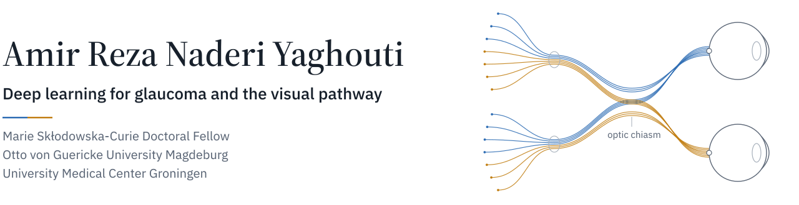
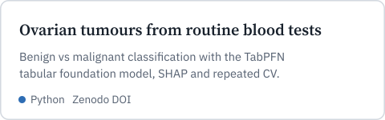
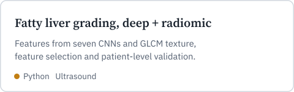
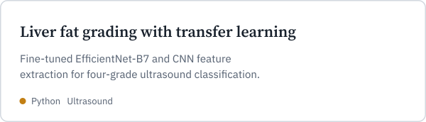

<picture><source media="(prefers-color-scheme: dark)" srcset="assets/banner-dark.svg"></picture>

<a href="https://amirnaderi.com"><picture><source media="(prefers-color-scheme: dark)" srcset="assets/link-amirnaderi-com-dark.svg"></picture></a>
<a href="https://scholar.google.com/citations?user=WmUoRTsAAAAJ&hl=en"><picture><source media="(prefers-color-scheme: dark)" srcset="assets/link-google-scholar-dark.svg"></picture></a>
<a href="https://orcid.org/0000-0002-9269-8084"><picture><source media="(prefers-color-scheme: dark)" srcset="assets/link-orcid-dark.svg"></picture></a>
<a href="https://www.linkedin.com/in/amirnaderiy/"><picture><source media="(prefers-color-scheme: dark)" srcset="assets/link-linkedin-dark.svg"></picture></a>
<a href="mailto:naderi.bme@gmail.com"><picture><source media="(prefers-color-scheme: dark)" srcset="assets/link-email-dark.svg"></picture></a>

 

I build deep learning methods for medical images, mostly around glaucoma. Glaucoma damages the optic nerve, but its effects reach along the whole visual pathway, from the retina through the optic chiasm to the brain. My PhD in the EGRET-AAA Horizon Europe network follows that path with fundus photographs and MRI.

### Research

**Glaucoma from fundus photographs.** Adapting retinal foundation models such as RETFound to detect and stage glaucoma, and testing which parts of the image the models really use beyond the optic nerve head.

**The optic chiasm on MRI.** Automated 3D segmentation of the optic chiasm to measure its volume as a structural marker of glaucoma.

**AI that clinicians can use.** Attention-based explanations, image-quality checks and desktop screening software built around these models.

### Selected repositories

<a href="https://github.com/Amirnaderiy/ovarian_tabpfn"><picture><source media="(prefers-color-scheme: dark)" srcset="assets/card-ovarian_tabpfn-dark.svg"></picture></a>
<a href="https://github.com/Amirnaderiy/Classification-of-the-grade-of-Non-alcoholic-fatty-liver"><picture><source media="(prefers-color-scheme: dark)" srcset="assets/card-nafld-hybrid-dark.svg"></picture></a>

<a href="https://github.com/Amirnaderiy/Classification-of-Liver-Fat"><picture><source media="(prefers-color-scheme: dark)" srcset="assets/card-liver-fat-dark.svg"></picture></a>
<a href="https://github.com/Amirnaderiy/websites-"><picture><source media="(prefers-color-scheme: dark)" srcset="assets/card-website-dark.svg"></picture></a>

### Publications

**Classification of nonalcoholic fatty liver grades using pre-trained convolutional neural networks and a random forest classifier on B-mode ultrasound images** 
Naderi Yaghouti AR, Shalbaf A. *Journal of Biomedical Physics and Engineering*, 2025. [Article](https://jbpe.sums.ac.ir/article_49907.html)

**Artificial intelligence for ovarian cancer detection with medical images: a review of the last decade (2013–2023)** 
Naderi Yaghouti AR, Shalbaf A, Alizadehsani R, Tan RS, Vijayananthan A, et al. *Archives of Computational Methods in Engineering*, 2025. [doi:10.1007/s11831-025-10268-x](https://doi.org/10.1007/s11831-025-10268-x)

**Machine learning approaches for early detection of non-alcoholic steatohepatitis based on clinical and blood parameters** 
Naderi Yaghouti AR, Zamanian H, Shalbaf A. *Scientific Reports*, 2024. [doi:10.1038/s41598-024-51741-0](https://doi.org/10.1038/s41598-024-51741-0)

**Automatic classification of non-alcoholic fatty liver using texture features from ultrasound images** 
Naderi Yaghouti AR, Shalbaf A, Maghsoudi A. *Tehran University Medical Journal*, 2021. [Article](https://tumj.tums.ac.ir/article-1-11130-en.html)

All publications are on [Google Scholar](https://scholar.google.com/citations?user=WmUoRTsAAAAJ&hl=en).

### Tools

Python, PyTorch, MONAI, TensorFlow and Keras, scikit-learn, XGBoost, LightGBM, SHAP, OpenCV, MATLAB, Git, and GPU clusters for training.

 

I am open to collaborations and postdoctoral positions in medical image analysis and ophthalmic AI. [Email me](mailto:naderi.bme@gmail.com) or find more on [amirnaderi.com](https://amirnaderi.com).
